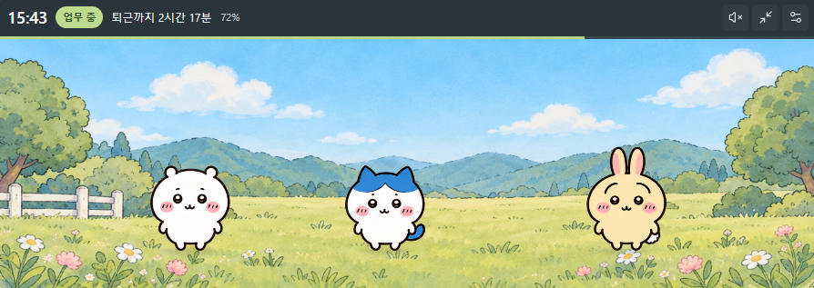

# 먼작귀 업무시간 위젯

치이카와·하치와레·우사기·모몽가 중 원하는 친구 1~3명을 골라 함께하는 생활형 위젯입니다. 친구들이 걷고 쉬며 업무 일정에 맞춰 점심을 먹고 퇴근 인사를 합니다. Windows용 Electron 앱과 브라우저에서 사용하는 웹 버전을 함께 제공합니다.



## 제공 형태

- **Windows 앱:** 독립된 창, 항상 위에 표시, 클릭 통과, 트레이 숨김·복원·종료를 지원합니다. 설치 파일로 배포하면 사용자에게 Node.js가 필요하지 않습니다.
- **웹 버전:** 설치·로그인 없이 브라우저에서 사용합니다. Windows 창 제어 기능은 숨기고, 설정은 각 사용자의 브라우저에 저장합니다.

공개 페이지: [먼작귀 업무시간 위젯](https://chiikawa-work-widget.vercel.app/). 웹 첫 화면에서 실제 위젯을 미리 보고 Windows 설치 파일을 다운로드할 수 있습니다. 설치·실행 순서와 바탕화면 바로가기 만드는 방법도 표시합니다.

## 주요 기능

- 출근·점심·퇴근 시간과 근무 요일 설정. 자정을 넘는 근무도 출근 날짜 기준으로 계산합니다.
- 현재 업무 상태, 남은 시간, 점심시간을 제외한 근무 진행률.
- 날짜별 점심 메뉴 저장과 식사 동작, 퇴근 인사와 휴식.
- 양방향 걷기·눈 깜빡임·클릭 반응·하트와 캐릭터별 소소한 행동.
- 설정의 '함께할 친구'에서 1~3명을 선택하고 저장하면 장면에 반영됩니다. 기본 구성은 기존 치이카와·하치와레·우사기이며 선택은 재실행 후에도 유지됩니다.
- 쓰다듬기·산책·출근 전·점심·퇴근·휴무·휴식 상황에 맞는 짧은 대사. 말풍선은 번갈아 표시하고 같은 상황의 대사를 연속으로 반복하지 않습니다.
- 자동 낮·노을·밤 전환 또는 배경 고정, 캐릭터 크기·불투명도 조절.
- 미니 모드, 20초 동작 미리보기, 선택 가능한 휴식 알림.
- 기본 음소거. 소리는 사용자가 켜고 화면과 상호작용한 경우에만 재생합니다.
- 설정 창의 고정된 저장 버튼과 내용 스크롤, 좁은 화면의 상태 문구 말줄임·툴팁.
- Windows 창 위치·크기 복원과 모니터 변경 대응, 절전·탭 복귀 시 현재 시각에 맞는 상태 복구.
- Windows 설치 앱의 새 버전 자동 확인과 트레이 수동 확인. 다운로드·재시작은 사용자가 동의한 경우에만 진행합니다.

미리보기는 업무 일정과 일별 기록을 바꾸지 않습니다. 숨김·절전 후 지난 휴식 알림을 몰아서 재생하거나, 재실행 시 퇴근 인사를 처음부터 반복하지 않습니다. 웹의 동작과 알림은 페이지가 열린 동안 제공하며 닫힌 브라우저에서 백그라운드 실행을 보장하지 않습니다.

## 개발 실행

Node.js와 npm이 필요합니다. 최초 설치는 의존성과 Electron 실행 파일을 내려받으므로 인터넷이 필요합니다. 설치 후 Windows 앱의 기본 기능은 오프라인으로 사용할 수 있습니다.

```powershell
cd "C:\Users\DYU\Desktop\종안\포폴모음\먼작귀"
npm.cmd ci
```

Windows 앱:

```powershell
npm.cmd start
```

로컬 웹:

```powershell
npm.cmd run web
```

기본 웹 주소는 `http://127.0.0.1:5178`입니다. 사용 중인 포트가 있으면 실행 출력에 표시된 다음 포트를 사용합니다.

npm 인증서 오류가 발생하면 인증서 검증을 끄지 말고, Node의 시스템 인증서를 사용하도록 설정한 뒤 설치합니다.

```powershell
$env:NODE_OPTIONS = (($env:NODE_OPTIONS + " --use-system-ca").Trim())
npm.cmd ci
```

## Windows 설치 파일

```powershell
npm.cmd run dist:win
```

`electron-builder.json`을 사용해 Windows x64 설치 파일을 `dist/desktop/`에 생성합니다. 첫 실행은 electron-builder 26.x와 제작 도구를 다운로드합니다.

- 현재 소스 버전의 파일명: `chiikawa-work-widget-setup-1.0.2-x64.exe`.
- 앱·설치 프로그램·제거 프로그램·바로가기에는 치이카와 아이콘을 사용합니다.
- 바탕화면·시작 메뉴 바로가기를 만들며 Windows 로그인 시 자동 실행은 등록하지 않습니다.
- 기존 설치와 같은 App ID를 유지합니다. 설치된 앱의 아이콘을 바꾸려면 위젯을 완전히 종료한 뒤 새 설치 파일을 설치합니다.
- 설치 파일은 Git에 커밋하지 않고 GitHub Releases에 첨부합니다. 이전 `dist/` 설치 파일은 보관용이며 새 결과물은 `dist/desktop/`에서 확인합니다.

웹의 Windows 다운로드 버튼은 공개된 `v1.0.2` Release의 실제 `.exe`에 직접 연결됩니다. 현재 파일은 약 114 MB입니다. 사용자는 설치 파일 하나만 받으면 되며 `latest.yml`·`.blockmap`은 앱의 자동 업데이트용입니다. 새 버전을 배포할 때는 GitHub Release에 설치 파일을 먼저 올린 뒤 `web/download-config.js`의 버전·크기·주소와 `index.html`의 기본 다운로드 링크·문구를 함께 갱신합니다. 방문자 브라우저가 GitHub API를 호출하지 않으므로 API 키나 추가 통신 권한이 필요하지 않습니다.

바탕화면 아이콘이 없으면 시작 메뉴에서 먼작귀 검색 → 앱 우클릭 → 파일 위치 열기 → 열린 폴더의 아이콘 우클릭 → 추가 옵션 표시 → 보내기 → 바탕 화면에 바로 가기 만들기를 선택합니다.

## 자동 업데이트 배포

Git에 소스만 push하면 설치된 앱은 바뀌지 않습니다. 새 버전의 설치 파일과 업데이트 정보를 GitHub Releases에 함께 배포해야 합니다. 웹의 Vercel 배포와 Windows 앱 배포는 별개입니다.

1. 첫 자동 업데이트 지원 버전은 `1.0.2`입니다. 기존 `1.0.1` 이하 사용자는 이 설치 파일을 한 번 직접 설치해야 합니다.
2. 프로젝트 폴더에서 `npm.cmd run dist:win`을 실행합니다. 이 명령은 파일만 생성하며 Release에 자동 업로드하지 않습니다.
3. GitHub 저장소의 Releases → Draft a new release에서 태그 `v1.0.2`를 생성합니다. 프리릴리스로 표시하지 않습니다.
4. `dist/desktop/`의 다음 **세 파일 모두**를 첨부한 뒤 Release를 공개합니다. 파일명이나 `latest.yml` 내용은 임의로 바꾸지 않습니다.

```text
chiikawa-work-widget-setup-1.0.2-x64.exe
chiikawa-work-widget-setup-1.0.2-x64.exe.blockmap
latest.yml
```

이후 업데이트는 소스를 수정하고 다음 명령으로 버전을 올린 뒤 새 설치 파일을 생성합니다.

```powershell
Set-Location -LiteralPath "C:\Users\DYU\Desktop\종안\포폴모음\먼작귀"
npm.cmd version patch --no-git-tag-version
npm.cmd run dist:win
```

새 버전과 같은 태그(예: `v1.0.3`)로 안정 Release를 만들고 해당 빌드의 세 파일을 모두 첨부합니다. 변경한 소스와 `package.json`·`package-lock.json`은 Git에도 업로드합니다. 설치 파일과 `latest.yml`은 소스 저장소가 아니라 Release 첨부 파일로 올립니다. 웹 다운로드 링크도 새 Release가 공개된 뒤 갱신합니다. 공개 저장소이므로 사용자에게 GitHub 로그인이나 토큰은 필요하지 않습니다.

설치 앱은 실행 약 8초 후, 실행 중 약 1시간마다, 절전 복귀 시(확인 간격 최소 15분) 새 버전을 확인합니다. 트레이 아이콘 우클릭 → 업데이트 확인으로 직접 확인할 수도 있습니다. 다운로드를 거절한 버전은 같은 실행 세션에서 다시 자동 안내하지 않습니다. 인터넷이 없거나 확인에 실패해도 위젯은 계속 작동하며 일반 종료에서는 업데이트를 강제 설치하지 않습니다. `npm start` 개발 실행과 웹 버전에서는 이 기능을 실행하지 않습니다.

업데이트는 HTTPS와 파일 체크섬 검증을 사용합니다. 코드 서명을 대신하지 않으므로 서명되지 않은 설치 파일의 Windows 보안 경고가 사라지는 것은 아닙니다. 실제 설치·다음 버전 업데이트·절전 복귀는 별도 수동 확인이 필요합니다.

## Vercel 배포

GitHub 저장소를 Vercel에서 Import합니다. 웹 배포 설정은 루트의 `vercel.json`에 포함되어 있습니다.

| 항목 | 설정 |
| --- | --- |
| Root Directory | 프로젝트가 저장소 루트면 기본값, 전체 모음 안에 있으면 `먼작귀` |
| Framework Preset | `Other` |
| Install Command | `npm ci --omit=dev --ignore-scripts` |
| Build Command | `node scripts/export-web.cjs` |
| Output Directory | `dist` |
| Environment Variables | 필요 없음 |

웹 배포에서는 Electron 설치를 실행하지 않고, 화면·공용 일정 모듈·필요한 이미지·Lucide만 출력 폴더에 복사합니다. 메인 프로세스·개인 설정·전체 `node_modules`는 웹 배포물에 포함하지 않습니다.

## 파일 구성

```text
assets/                 배경·캐릭터·음식·아이콘과 아이콘 원본
docs/screenshots/       README 화면 캡처
renderer/               Windows와 웹이 공유하는 화면·스타일·동작
web/                    브라우저 상태 저장·설정 대화상자
scripts/                웹 실행·배포 파일 생성·아이콘 변환
index.html              웹 진입점
main.cjs                Electron 창·트레이·설정 파일 관리
updater.cjs             GitHub Release 업데이트 확인·다운로드·설치
preload.cjs             제한된 Electron IPC 연결
schedule.js             공용 일정 계산과 설정 검증
schedule.cjs            Electron용 일정 모듈 진입점
electron-builder.json   Windows 설치 파일 설정
vercel.json             웹 배포 설정
```

`assets/chiikawa-source.png`와 `scripts/prepare-icons.ps1`는 PNG·ICO 아이콘을 다시 만들기 위해 보존합니다. 사용하지 않는 구형 캐릭터 이미지와 임시 실행 로그는 정리했습니다.

`node_modules/`와 `dist/`는 로컬 실행·빌드 결과용이므로 Git에 올리지 않습니다. 로그·임시 파일·환경변수·설치 파일도 제외합니다. `package-lock.json`, 공용 일정 진입점, 실제 이미지와 배포 스크립트는 실행·재현에 필요한 파일입니다.

## 저장과 보안

- Windows 설정·최근 60개 근무 날짜 기록: `%APPDATA%\MeonjakkwiWidget\settings.json`.
- 웹 설정·기록: 해당 브라우저의 `localStorage`. Windows 앱·다른 사용자·다른 기기와 공유되지 않으며 사이트 데이터 삭제 시 사라질 수 있습니다.
- Electron은 `contextIsolation`·`sandbox`를 사용하고 `nodeIntegration`을 끕니다. IPC 요청 창·프레임·입력을 검사하고 화면의 외부 탐색·원격 리소스·추가 창 열기를 차단합니다. 업데이트 확인·다운로드는 메인 프로세스의 별도 네트워크 세션에서만 수행합니다.
- 웹은 동일 출처 프레임만 사용합니다. 로그인·광고·추적·자동 실행 등록을 추가하지 않았습니다.

## 이미지와 구현 범위

배경은 낮·노을·밤 3행, 기존 세 친구는 `characters-atlas-v2.png`, 모몽가는 별도 `momonga-atlas.png`의 2행×3열, 음식은 2행×3열 배열을 사용합니다. 실제 프레임 좌표와 투명 여백을 보정해 공통 크기·발 기준선에 맞추고, 오른쪽 걷기는 왼쪽 걷기 프레임을 반전합니다. 걷기 상체는 같은 그림을 유지하고 식사에는 그날 메뉴 이미지를 합성합니다. 선택 인원에 맞춰 산책 구간·식사 간격·퇴근 위치를 계산합니다.

치이카와의 짧은 반응, 하치와레의 다정한 말투, 우사기의 감탄사, 모몽가의 관심과 칭찬을 조르는 성격을 반영했습니다. 성격은 [공식 애니메이션 캐릭터 안내](https://www.anime-chiikawa.jp/chara.html)와 [모몽가 소개](https://www.anime-chiikawa.jp/info.html?k=%2Fentry%2F0915)를 참고했습니다. 한국어 대사는 공식 번역이나 원작 대사집이 아니라 위젯 상황에 맞춘 팬 창작 표현을 중심으로 구성했습니다.

이미지와 치이카와 얼굴 아이콘은 생성 도구로 준비한 그림이며 공식 캐릭터 원본이나 정식 배포 자료가 아닙니다. 이 프로젝트는 캐릭터·이미지의 외부 배포나 상업적 사용 권한을 제공하지 않습니다.

다양한 Windows 배율·절전·모니터 전환과 실제 설치 파일은 별도 수동 확인이 필요합니다.
